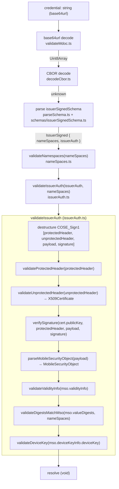

# Internal architecture

`validateMdoc` is the single public entry point. It orchestrates a fixed
sequence of internal components, each with a narrow responsibility, that
together take a base64url-encoded credential string from raw bytes to a
fully validated `IssuerSigned` structure. This document describes that
sequence and maps each step to its module.

For how to use the library, see [README.md](../README.md); for the exact rules,
limits, and error messages each step enforces, see
[validation.md](validation.md); for the conventions that govern changes, see
[AGENTS.md](../AGENTS.md).

## Execution flow

Any step that fails throws an `MdocValidationError`; the promise rejects and no
later step runs. If every step passes, `validateMdoc` resolves with no value.

## Top-level sequence (`validateMdoc`)

Source: `src/validateMdoc.ts`.

| #   | Step             | Module / function                                                                              | Responsibility                                                                                                           |
| --- | ---------------- | ---------------------------------------------------------------------------------------------- | ------------------------------------------------------------------------------------------------------------------------ |
| 1   | base64url decode | `validateMdoc.ts` → `base64UrlToUint8Array` (uses `jose` `base64url`)                          | Decode the credential string to `Uint8Array`; throw `INVALID_BASE64URL` on failure.                                      |
| 2   | CBOR decode      | `decodeCbor.ts` → `decodeCbor(bytes, "IssuerSigned")`                                          | Decode bytes to a CBOR value with `rejectDuplicateKeys` and `saveOriginal`; throw `INVALID_CBOR` on failure.             |
| 3   | schema parse     | `parseSchema.ts` → `parseSchema(issuerSignedSchema, …, "IssuerSigned")`                        | Validate the structure against `issuerSignedSchema`; throw `INVALID_SCHEMA` on failure. Produces a typed `IssuerSigned`. |
| 4   | namespace checks | `nameSpaces.ts` → `validateNamespaces(issuerSigned.nameSpaces)`                                | Re-parse each item and reject duplicate digest IDs / element identifiers.                                                |
| 5   | issuer auth      | `issuerAuth.ts` → `await validateIssuerAuth(issuerSigned.issuerAuth, issuerSigned.nameSpaces)` | Validate the COSE_Sign1, signature, MSO, validity, digests, and device key.                                              |

The data passed between steps: step 1 yields `Uint8Array`; step 2 yields an
`unknown` CBOR value; step 3 yields a typed `IssuerSigned` with two properties,
`nameSpaces` and `issuerAuth`; both are then handed to steps 4 and 5.

## `IssuerSigned` shape

`issuerSignedSchema` (`src/schemas/issuerSignedSchema.ts`) produces:

- `nameSpaces` — a record of namespace → array of tag-24 (encoded CBOR)
  `IssuerSignedItemBytes`. The items are **not** decoded by this schema; they
  remain encoded blobs until a later step decodes and parses them.
- `issuerAuth` — a four-element COSE_Sign1 tuple
  `[protectedHeader, unprotectedHeader, payload, signature]`, where
  `unprotectedHeader` is a `Map<number, Uint8Array>` (the `bstr` value type is
  what restricts `x5chain` to a single certificate).

Both `nameSpaces` and `issuerAuth` are passed into `validateIssuerAuth`;
`nameSpaces` is needed again there for digest matching.

## `validateIssuerAuth` sub-steps

Source: `src/issuerAuth.ts`. The function destructures the COSE_Sign1 tuple and
runs the following in order. The ordering is deliberate: the signature is
verified **before** anything reads the MSO payload, so every downstream check
operates on signed data.

| #   | Sub-step           | Function                                                               | Input → output                                | Responsibility                                                                                                        |
| --- | ------------------ | ---------------------------------------------------------------------- | --------------------------------------------- | --------------------------------------------------------------------------------------------------------------------- |
| 1   | protected header   | `validateProtectedHeader(protectedHeader)`                             | `Uint8Array` → void                           | Decode and require a single `alg` parameter equal to `-7` (ES256).                                                    |
| 2   | unprotected header | `validateUnprotectedHeader(unprotectedHeader)`                         | `Map<number, Uint8Array>` → `X509Certificate` | Require a single `x5chain` (33) that parses as one X.509 certificate.                                                 |
| 3   | signature          | `verifySignature(cert.publicKey, protectedHeader, payload, signature)` | public key + bytes → void                     | Build the COSE `Signature1` structure, encode it, and verify (ES256 / P-1363).                                        |
| 4   | MSO parse          | `parseMobileSecurityObject(payload)`                                   | `Uint8Array` → `MobileSecurityObject`         | Parse the payload as tag-24 `MobileSecurityObjectBytes`, decode its contents, and parse `mobileSecurityObjectSchema`. |
| 5   | validity info      | `validateValidityInfo(mso.validityInfo)`                               | `ValidityInfo` → void                         | Compare `signed` / `validFrom` / `validUntil` / `expectedUpdate` against `new Date()` captured at call time.          |
| 6   | digest matching    | `validateDigestsMatchMso(mso.valueDigests, nameSpaces)`                | digests + namespaces → void                   | Hash each presented item's original bytes and match it to an MSO digest (selective disclosure).                       |
| 7   | device key         | `await validateDeviceKey(mso.deviceKeyInfo.deviceKey)`                 | `Map` → void                                  | Require EC2 / P-256 with exactly keys `[1, -1, -2, -3]`, importable as an ECDSA key.                                  |

### Intermediate outputs

- `validateUnprotectedHeader` returns an `X509Certificate`; its `publicKey` is
  the only part consumed downstream (by `verifySignature`).
- `parseMobileSecurityObject` is a two-layer parse: the payload is first parsed
  as a tag-24 wrapper (`encodedDataTag`, label `MobileSecurityObjectBytes`),
  then its `contents` are CBOR-decoded and parsed as `MobileSecurityObject`
  (label `MobileSecurityObject`). The resulting `MobileSecurityObject` supplies
  `validityInfo`, `valueDigests`, and `deviceKeyInfo.deviceKey` to the three
  checks that follow.
- `validateDigestsMatchMso` re-parses each presented item with
  `issuerSignedItemSchema` (to read its `digestID`) and hashes the item's
  original `IssuerSignedItemBytes`, recovered via `getEncoded` (enabled by
  `saveOriginal` in `decodeCbor`). Items are therefore schema-parsed both here
  and earlier in `validateNamespaces`.

## Component summary

| Module                       | Key exports                           | Role                                                                   |
| ---------------------------- | ------------------------------------- | ---------------------------------------------------------------------- |
| `src/index.ts`               | `validateMdoc`, `MdocValidationError` | Public surface of the package.                                         |
| `src/validateMdoc.ts`        | `validateMdoc`                        | Top-level orchestrator (steps 1–5 above).                              |
| `src/decodeCbor.ts`          | `decodeCbor`                          | CBOR decode with tag-0/1004 overrides and `saveOriginal`.              |
| `src/parseSchema.ts`         | `parseSchema`                         | Run a Zod schema and convert failures to `INVALID_SCHEMA`.             |
| `src/nameSpaces.ts`          | `validateNamespaces`                  | Re-parse items; reject duplicate digest IDs / element identifiers.     |
| `src/issuerAuth.ts`          | `validateIssuerAuth`                  | COSE_Sign1 / signature / MSO / validity / digests / device key.        |
| `src/schemas/*`              | schema definitions + inferred types   | Zod schemas for `IssuerSigned`, items, element values, MSO, CBOR tags. |
| `src/constants/*`            | `COSE_*`, `TAGS`                      | COSE and CBOR tag constants used across the validators.                |
| `src/MdocValidationError.ts` | `MdocValidationError`, `errorMessage` | Error type (with `code`) and a message helper.                         |

## How modules depend on each other

Modules communicate through named exports and the inferred Zod types
(`IssuerSigned`, `IssuerAuth`, `NameSpaces`, `MobileSecurityObject`,
`ValidityInfo`, `ValueDigests`). The orchestrator (`validateMdoc.ts`) depends on
the decoder, the schema parser, and the two validators; `issuerAuth.ts` depends
on the schema parser, the decoder, the MSO and item schemas, and the COSE
constants. Each validator throws `MdocValidationError`; none returns a
success/failure flag, so composition is simply "call in order and let the first
failure propagate."
